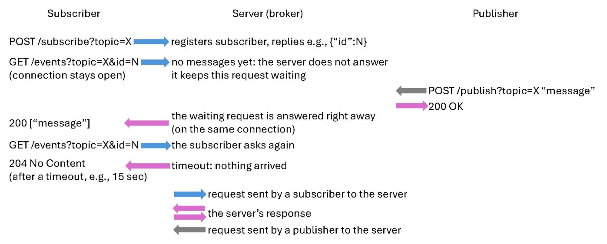

# Extension

The publish-subscribe pattern lets clients receive messages on a topic without knowing who produces them or when. Publishers send messages on a topic to a broker, and the broker forwards each message to every subscriber of that topic. Publishers and subscribers never communicate directly, and they do not need to know about each other.

Your task is to extend your HTTP server from Part 1 into a simple pub-sub broker. The broker must run in the same http_server binary and on the same port as the file server, and it must still follow the networking rules of Part 1.

Operations
Your broker should support the following four operations.

1. `POST /subscribe?topic=X` registers a new subscriber on topic X, and responds 201 "Created" with the subscriber's id, e.g., {"id":N}. The subscriber uses this id in later requests.
2. `POST /unsubscribe?topic=X&id=N` removes subscriber N.
3. `POST /publish?topic=X` sends the request body as a message to every current subscriber of X.
4. `GET /events?topic=X&id=N` delivers subscriber N's messages, using (a) long polling: the server holds the request until a message arrives or a timeout expires, and the subscriber then polls again, and it responds 204 "No Content" if nothing arrives within the timeout; or (b) streaming: the server keeps one response open and writes each message to it as it arrives; or (c) any other approach that delivers a message to a waiting subscriber as soon as it is published, as long as you can explain your choice.

Requests with a missing topic or invalid id should return 400 "Bad Request", requests for an unknown subscriber 404 "Not Found", and other methods 501 "Not Implemented".

The figure below shows an example of how a subscriber receives a message with long polling. Note that all requests are sent by the clients; the broker only responds to them, and the message is delivered in the response to the subscriber's waiting GET /events request:

## Concurrency

Every request runs in its own Go routine, so the broker's state (topics, subscribers and their queues) is shared and must be protected; you could keep it simple, such as using a single mutex for the whole broker. Your broker should handle concurrent publishers and subscribers, so that each message gets a sequence number and every subscriber receives the messages of its topic in that order. Subscribers may subscribe and unsubscribe at any time, and only receive messages published while they are subscribed. Give each subscriber a bounded queue (e.g. a buffered channel), and make sure publishing never blocks: if a subscriber's queue is full, it is fine to simply skip that subscriber for that message. Long pollings that are waiting for messages may be excluded from the limit of 10 concurrent Go routines from Part 1, since they are not doing any work while they wait.

Strongly recommended: use containers to help you build this and reuse it later for further labs
Look at either Docker, LXC or Vagrant to implement your server. This way you will never have portability issues, and it will make your solution cleaner. Bonus for this will also be considered based on the cleanliness of your code/solution.
